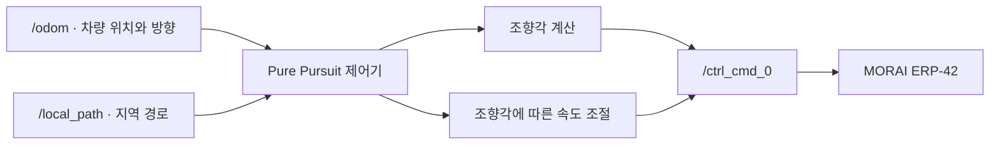

# 자율주행 PG 응용

**MORAI 시뮬레이터와 ROS를 활용한 자율주행 PG 응용 수업의 실습·과제·통합 주행 프로젝트 결과 모음입니다.**

시뮬레이션 환경 구축부터 센서 데이터 수집, 신호등 이미지 라벨링, LiDAR 장애물 인지, Pure Pursuit 경로 추종까지의 과정을 정리했습니다. 개별 과제의 제출물은 이 저장소에서, ERP-42 통합 주행 코드는 별도 [MORAI_Simulation](https://github.com/KweonTJ/MORAI_Simulation) 저장소에서 관리합니다.

## 전체 수행 내용

| 단계 | 수행 내용 | 주요 결과물 |
| --- | --- | --- |
| 환경 구축 | Ubuntu 환경에서 MORAI 실행, ROS Noetic 개발 환경 구성 | 실행 결과 보고서, Dockerfile, 실행 스크립트 |
| 센서 연동 | Camera·LiDAR·GPS·IMU 설정 및 ROS 데이터 수집 | 센서 설정 JSON, rosbag |
| 데이터 준비 | 카메라 이미지 추출 및 신호등 클래스 라벨링 | 이미지 데이터, YOLO 형식 라벨, 클래스 목록 |
| 장애물 인지 | LiDAR ROI 설정, 지면 제거, 클러스터링 및 RViz 시각화 | launch 설정, 클러스터링 결과 화면 |
| 경로 추종 | 위치·지역 경로를 이용한 Pure Pursuit 조향 및 코너 감속 | 제어 코드, 기록한 주행 경로 |
| 통합 주행 | 위치 추정·신호등 인식·장애물 회피·경로 추종 결합 | `MORAI_Simulation`의 통합 launch와 주행 노드 |

## 저장소 구성

```text
Autonomous_driving_PG_application/
├── Homework/
│   ├── Homework 1/       # MORAI 설치 및 실행 결과
│   ├── Homework 2/       # 센서 설정과 rosbag
│   ├── Homework 3/       # 신호등 라벨링·LiDAR 클러스터링 결과
│   └── Homework 4/       # Pure Pursuit 제어 코드와 주행 경로
├── MORAI_Simulation/    # 별도 Git 저장소 참조
├── Ubuntu 20.04/        # ROS Noetic Docker 개발 환경
└── README.md
```

## 과제별 결과

### Homework 1 · MORAI 환경 구축

로컬 환경에서 MORAI를 실행하고 C-track의 ERP-42 차량 화면을 기록했습니다.

- [설치 및 실행 결과 보고서](<Homework/Homework%201/Homework%201.pdf>)
- [과제 안내 자료](<Homework/Homework%201/과제1%20-%20모라이%20설치.pdf>)

### Homework 2 · 센서 설정 및 데이터 수집

Camera, LiDAR, GPS, IMU의 센서 설정을 저장하고 ROS 토픽을 rosbag으로 기록했습니다.

| 기록된 토픽 | 메시지 타입 |
| --- | --- |
| `/image_jpeg/compressed` | `sensor_msgs/CompressedImage` |
| `/velodyne_points` | `sensor_msgs/PointCloud2` |
| `/gps` | `morai_msgs/GPSMessage` |
| `/imu` | `sensor_msgs/Imu` |

- [센서 설정 JSON](<Homework/Homework%202/2023042028_권택주_sensor_config.json>)
- [센서 데이터 rosbag](<Homework/Homework%202/202304208_권택주_sensor_data.bag>)
- [센서 연동·녹화 참고자료](<Homework/Homework%202/자율주행%20PG응용%20과제2%20참고자료.pdf>)

센서 설정 JSON의 LiDAR 토픽은 `/lidar3D`이며, 저장된 rosbag의 LiDAR 토픽은 `/velodyne_points`입니다. Homework 3의 launch에는 두 토픽을 연결하는 relay가 포함돼 있습니다.

### Homework 3 · 신호등 라벨링 및 LiDAR 클러스터링

**신호등 데이터**

카메라 이미지와 YOLO 형식의 바운딩 박스 라벨을 저장했습니다.

| 클래스 ID | 클래스명 | 의미 |
| --- | --- | --- |
| 0 | `red` | 빨간불 |
| 1 | `yellow` | 노란불 |
| 2 | `straight` | 직진 신호 |
| 3 | `left_straight` | 좌회전·직진 신호 |

현재 저장소에는 이미지 **1,444장**과 라벨 파일 **20개**가 포함돼 있습니다. 라벨 파일은 `frame*.xml.txt`라는 이름으로 저장돼 있으며, 내용은 클래스 ID와 정규화된 좌표를 사용하는 YOLO 형식입니다. 학습에 사용할 때는 이미지와 라벨의 이름을 맞춰 별도로 구성해야 합니다.

- [이미지와 라벨](<Homework/Homework%203/label/images/>)
- [클래스 정의](<Homework/Homework%203/label/predefined_classes.txt>)

**LiDAR 장애물 인지**

ROI와 RANSAC 지면 제거, HDBSCAN 클러스터링 파라미터를 조정하고 장애물 위치를 RViz에서 확인했습니다. launch는 `/lidar3D`를 `/velodyne_points`로 중계한 뒤 `lidar_pkg`의 클러스터링 노드를 실행합니다.

- [클러스터링 launch](<Homework/Homework%203/2023042028_권택주_lidar_clustering.launch>)
- [참고 패키지 및 과제 자료](<Homework/Homework%203/참고자료/>)


### Homework 4 · Pure Pursuit 경로 추종

`/odom`에서 차량 위치와 방향을 받고, `/local_path`의 전방 주시점을 차량 좌표계로 변환해 조향각을 계산합니다. 계산한 조향각과 목표 속도는 `morai_msgs/CtrlCmd` 메시지로 발행합니다.



| 항목 | 코드 설정 |
| --- | --- |
| 제어 주기 | 15 Hz |
| 전방 주시 거리 `lfd` | 3.5 m |
| 차량 축간 거리 설정 | 1.0 m |
| 기본 목표 속도 | 15 km/h |
| 코너 감속 | 조향각 크기에 따라 12 또는 8 km/h |
| 조향각 제한 | ±0.7 rad |

- [Pure Pursuit 제어 코드](<Homework/Homework%204/pure_pursuit.py>)
- [기록한 경로 `morai_path.txt`](<Homework/Homework%204/morai_path.txt>)
- [경로 생성·제어 참고자료](<Homework/Homework%204/과제4_참고자료.pdf>)

이 제어기는 `morai_path.txt`를 직접 읽지 않습니다. 위치 추정 노드와 경로 발행 노드를 별도로 실행해 `/odom`, `/local_path`를 공급해야 합니다.

## MORAI 통합 주행 프로젝트

[MORAI_Simulation](https://github.com/KweonTJ/MORAI_Simulation)에서는 ERP-42의 C-track 주행을 위해 개별 기능을 통합했습니다.

| 기능 | 주요 코드 |
| --- | --- |
| GPS·IMU 기반 위치 추정 | `gpsimu_parser.py` |
| YOLO 신호등 인식 및 출발 신호 전달 | `yolo_detection.py` |
| LiDAR 장애물 인지 | `midterm_lidar_obstacle_detector.py` |
| 전역·지역 경로 생성 및 장애물 회피 | `midterm_local_path_planner.py` |
| Pure Pursuit 조향·속도 제어·도착 정지 | `midterm_planning_pure_pursuit_pid.py` |

통합 실행 패키지는 해당 저장소의 `catkin_ws/src/team_9`입니다. 경로 파일 `path/path.txt`, 모델 `model/best.pt`, 센서·시작 위치 설정은 패키지 내부에서 관리합니다.

워크스페이스 빌드와 의존성 준비 후, ROS 환경을 불러온 터미널에서 다음과 같이 실행합니다.

```bash
# 터미널 1: MORAI와 연결할 ROS Bridge
roslaunch rosbridge_server rosbridge_websocket.launch
```

```bash
# 터미널 2: 위치 추정·인지·경로 계획·제어
roslaunch team_9 midterm_integrated.launch
```

MORAI에는 통합 프로젝트의 센서 설정을 적용하고, ROS Bridge 연결과 제어 입력을 설정해야 합니다. 과제 2의 센서 설정과 통합 프로젝트의 센서 설정은 구분해 사용합니다.

구현 내용과 실행 코드는 [통합 프로젝트 README](https://github.com/KweonTJ/MORAI_Simulation#readme)를 참고하세요.

## 개발 환경 및 사용 방법

### 실습 환경

| 구분 | 구성 |
| --- | --- |
| 운영체제 | Ubuntu 20.04 |
| ROS | ROS 1 Noetic |
| 언어 | Python 3 |
| 시뮬레이터 | MORAI SIM · 과제 안내 버전 24.R2.H2 |
| 차량·맵 | ERP-42 · C-track |
| 시각화·분석 | RViz, ROS 토픽 도구, rosbag |
| 개발 환경 | Docker, X11 GUI 연동 |

통합 주행에는 `morai_msgs`, `cv_bridge`, NumPy, pyproj, OpenCV, Ultralytics 등이 필요합니다. 과제 3의 기존 클러스터링 코드에는 scikit-learn과 HDBSCAN도 사용됩니다. Dockerfile은 ROS 개발 환경을 구성하며, 이러한 추가 Python 의존성을 모두 설치하지는 않습니다.

### 저장소 받기

```bash
git clone https://github.com/KweonTJ/Autonomous_driving_PG_application.git
cd Autonomous_driving_PG_application

# 통합 주행 소스가 필요할 때 별도로 받기
git clone https://github.com/KweonTJ/MORAI_Simulation.git MORAI_Simulation
```

현재 상위 저장소의 `MORAI_Simulation` 항목은 Git 참조로 저장돼 있고 `.gitmodules`가 없습니다. 따라서 일반 clone만으로 통합 주행 소스가 채워지지는 않습니다. 이미 별도 저장소로 받아 둔 경우에는 두 번째 clone을 생략합니다. 통합 프로젝트 내부의 외부 메시지 패키지 등도 빌드 전에 준비해야 합니다.

### ROS Noetic Docker 환경

[Ubuntu 20.04](<Ubuntu%2020.04/>) 폴더에는 Docker 이미지 빌드, 컨테이너 실행, 실행 중인 컨테이너 접속 스크립트가 있습니다.

`run_noetic.sh`의 `ROOT`는 원래 작업 PC의 절대경로입니다. 호스트에서 공유할 실제 작업 폴더로 수정한 뒤 사용합니다. 빌드할 이미지 이름은 실행 스크립트에 맞춰 지정합니다.

```bash
cd "Ubuntu 20.04"

# run_noetic.sh가 사용하는 이미지 이름으로 빌드
IMAGE_NAME=morai-noetic-topic:camera bash build_noetic.sh

# 컨테이너 생성 또는 시작 후 접속
bash run_noetic.sh
```

다른 터미널에서 실행 중인 컨테이너에 접속하려면 다음 명령을 사용합니다.

```bash
cd "Ubuntu 20.04"
bash enter_noetic.sh
```

### 수집 데이터 확인

ROS Noetic과 필요한 메시지 패키지가 준비된 환경에서, 저장소 루트를 기준으로 실행합니다.

```bash
rosbag info "Homework/Homework 2/202304208_권택주_sensor_data.bag"
```

데이터 재생은 한 터미널에서 `roscore`를 실행한 뒤, 다른 터미널에서 수행합니다.

```bash
rosbag play "Homework/Homework 2/202304208_권택주_sensor_data.bag"
```

## 관련 자료

- [과제 결과 모음](Homework/)
- [ROS Noetic Docker 환경](<Ubuntu%2020.04/>)
- [MORAI 통합 주행 저장소](https://github.com/KweonTJ/MORAI_Simulation)
